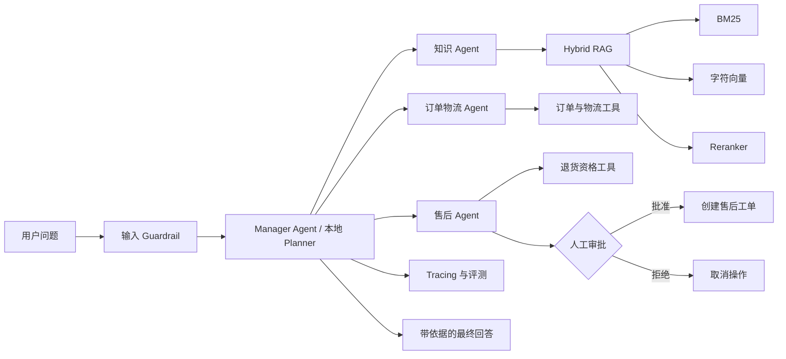

# 电商智能客服 Agentic RAG Demo

这是一个面向 AI 产品经理学习的电商客服 Agent 项目。项目不仅回答知识库问题，还能识别用户任务、调用订单与物流工具、记住多轮对话中的订单号，并在创建售后工单前等待人工审批。

项目优先保证流程透明、代码可读和 Windows 可运行。所有商品、订单和物流数据均为虚构教学数据。

## 项目亮点

- Agentic RAG：Agent 自主决定何时检索知识库、何时查询业务工具。
- 本地混合检索：BM25 + 哈希字符向量 + 可解释重排，不依赖网络或向量数据库。
- 多 Agent 编排：知识、订单物流、售后三类专业 Agent，由 Manager Agent 调用并整合答案。
- Function Calling：订单、物流、退货资格和售后工单均封装为工具。
- MCP：可通过本地 stdio MCP Server 暴露知识与订单工具。
- Session Memory：支持“查询 ORD1001”后继续追问“物流到哪里了”。
- Human-in-the-loop：创建售后工单前必须由用户明确批准。
- Guardrails：限制输入长度、日志敏感信息脱敏、低证据拒答。
- Tracing 与 Evals：保存本地 JSONL Trace，并提供 8 条评测用例和 6 项单元测试。

## RAG 与 Agent 的区别

普通 RAG 的主要流程是“检索文档并生成答案”。本项目中的 Agent 会先判断用户目标，再组合不同工具完成任务。例如用户要求为订单申请退货时，Agent 需要：

1. 提取或追问订单号。
2. 查询订单状态。
3. 根据签收时间和商品类型判断退货资格。
4. 生成待执行动作。
5. 暂停并等待用户确认。
6. 获得批准后创建售后工单。

## 系统架构



## 三种运行模式

| 模式 | 是否需要 API Key | 主要用途 |
|---|---:|---|
| `local` | 否 | 学习 Agent 规划、工具、记忆、审批和检索流程 |
| `sdk` | 是 | OpenAI Agents SDK 多 Agent 与 Function Calling |
| `mcp` | 是 | Agents SDK + 本地 stdio MCP Server |

`local` 模式完全使用 Python 标准库，可直接运行。`sdk` 和 `mcp` 模式需要 OpenAI Platform API Key。ChatGPT 或 Codex 订阅不等同于 API Key 或 API 额度。

## 项目结构

```text
agent_rag_demo/
├── README.md
├── requirements.txt
├── .env.example
├── app.py                       # CLI 入口
├── evaluate.py                  # 本地评测入口
├── mcp_server.py                # MCP 工具服务
├── agent_app/
│   ├── config.py                # 参数和环境变量
│   ├── local_agent.py           # 零 API 的 Agent Planner
│   ├── openai_agents.py         # Agents SDK、多 Agent、审批
│   ├── tools.py                 # 知识、订单、物流、售后工具
│   ├── memory.py                # 会话记忆
│   ├── guardrails.py            # 输入和日志安全控制
│   ├── tracing.py               # JSONL Trace
│   └── schemas.py               # 共享数据结构
├── rag/
│   ├── loader.py
│   ├── chunker.py
│   └── hybrid_retriever.py
├── data/
│   ├── products.md
│   ├── shipping.md
│   ├── returns.md
│   ├── membership.md
│   └── orders.json
├── evaluation/test_cases.json
└── tests/test_agent.py
```

## 快速启动

### 1. 本地模式：无需安装依赖

在 PowerShell 中进入项目目录：

```powershell
cd agent_rag_demo
python app.py --mode local
```

如果电脑通过 `py` 启动 Python，也可以使用：

```powershell
py app.py --mode local
```

单次提问并显示检索明细：

```powershell
python app.py --mode local --question "购买商品后多少天内可以退货？" --show-retrieval
```

可以测试以下模拟订单：

- `ORD1001`：已发货，可查询物流。
- `ORD1002`：已签收，在演示快照日期内允许无理由退货。
- `ORD1003`：定制刻字商品，不支持无理由退货。

体验人工确认流程：

```text
你：为 ORD1002 申请退货
Agent：如需创建售后工单，请回复“确认”
你：确认
Agent：已创建售后工单……
```

### 2. SDK 模式：多 Agent

建议使用 Python 3.11 或 3.12 创建虚拟环境：

```powershell
python -m venv .venv
.\.venv\Scripts\Activate.ps1
python -m pip install -r requirements.txt
Copy-Item .env.example .env
```

编辑 `.env`，填写从 OpenAI Platform 创建的 API Key。模型字段可以留空，让 SDK 使用默认模型；也可以填写账户中可用的模型。

```dotenv
OPENAI_API_KEY=你的Platform_API_Key
OPENAI_MODEL=
```

启动多 Agent：

```powershell
python app.py --mode sdk
```

该模式采用 Manager-style 编排：主 Agent 保持最终回答所有权，将知识、订单物流和售后任务交给三个专业 Agent 工具处理。

### 3. MCP 模式

完成上述依赖与 API Key 配置后运行：

```powershell
python app.py --mode mcp
```

程序会自动启动本地 `mcp_server.py` 子进程，并通过 stdio 发现以下工具：

- `search_knowledge`
- `query_order`
- `track_logistics`
- `check_return_eligibility`

创建售后工单仍由 Agents SDK 的审批工具处理，不通过 MCP 绕过审批。

## 运行测试

单元测试：

```powershell
python -m unittest discover -s tests -v
```

评测集：

```powershell
python evaluate.py
```

评测覆盖商品知识、订单状态、物流查询、退货资格、人工审批、会员规则、运费计算和知识库无法回答的问题。

## 按执行顺序理解核心代码

1. `app.py`：读取参数并选择 local、sdk 或 mcp 模式。
2. `agent_app/config.py`：加载切块、Top-K、检索阈值和模型配置。
3. `rag/loader.py`：读取 Markdown 知识库。
4. `rag/chunker.py`：按照标题和固定长度生成 Chunk。
5. `rag/hybrid_retriever.py`：执行 BM25、字符向量检索及重排。
6. `agent_app/tools.py`：将检索、订单、物流、退货和工单封装为工具。
7. `agent_app/local_agent.py`：展示不依赖 LLM 的 Agent 规划、记忆和审批过程。
8. `agent_app/openai_agents.py`：使用 Agents SDK 构建多 Agent、工具调用和审批中断。
9. `mcp_server.py`：通过 MCP 标准暴露只读业务工具。
10. `evaluate.py`：从产品指标角度验证任务是否正确完成。

## 关键产品设计

### 为什么保留 local 模式

如果所有流程都藏在 LLM 中，学习者很难判断错误发生在意图识别、检索、工具参数还是回答生成。local 模式将每一步显式展示，并能在没有 API Key 时验证核心产品逻辑。

### 为什么售后工单需要审批

知识查询属于只读操作，而创建工单会改变系统状态。Agent 即使判断正确，也不应在用户没有确认时直接执行。项目将副作用工具设置为 Human-in-the-loop，有助于理解 Agent 产品中的权限边界与可控性。

### 为什么使用混合检索

BM25 对订单规则、金额和商品名等精确词匹配效果较好；字符向量可以补充表达差异；重排阶段结合关键词覆盖率和标题信息调整顺序。三个分数都会在 `--show-retrieval` 中展示，方便分析 Bad Case。

## AIPM 评测指标

- Intent Accuracy：是否识别正确的用户任务。
- Tool Selection Accuracy：是否选择了正确工具。
- Tool Argument Accuracy：订单号、Top-K 等参数是否正确。
- Task Completion Rate：多步骤任务是否完成。
- Hit Rate@K：预期知识文档是否出现在 Top-K。
- Groundedness：回答是否可以被知识片段或工具结果支持。
- Abstention Accuracy：证据不足时是否正确拒答。
- Approval Compliance：有副作用工具是否始终等待审批。
- Latency / Cost：API 模式下的响应时间和调用成本。

## AIPM 面试可以如何介绍

项目重点不是“调用了大模型”，而是把客服流程拆成知识问答、订单查询、物流查询和售后操作四类能力，并为不同风险等级设计工具权限、拒答策略与人工确认。评测时将检索、工具选择和最终答案分层，避免只用主观感受判断效果。

## 已知限制

- 所有订单与物流信息都是本地模拟数据，不连接真实电商系统。
- 本地字符向量不等同于生产级语义 Embedding；生产环境可替换为企业 Embedding 服务和向量数据库。
- CLI 只用于教学，没有账户、鉴权、并发和生产级审计能力。
- API 模式会产生模型调用费用，具体可用模型、价格和限额以 OpenAI Platform 账户为准。

## 官方技术参考

- [OpenAI Agents SDK Quickstart](https://developers.openai.com/api/docs/guides/agents/quickstart)
- [Orchestration and handoffs](https://developers.openai.com/api/docs/guides/agents/orchestration)
- [Guardrails and human review](https://developers.openai.com/api/docs/guides/agents/guardrails-approvals)
- [Integrations and observability](https://developers.openai.com/api/docs/guides/agents/integrations-observability)
