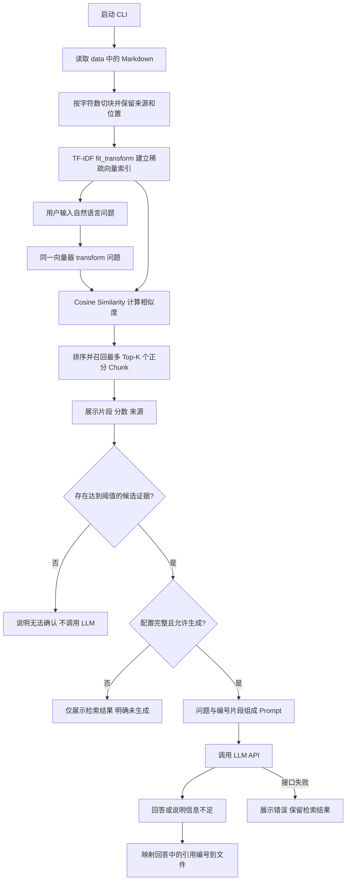

# 面向 AI PM 学习的轻量 RAG Demo

**使用 Codex 订阅生成回答：** 已增加可选 `--backend codex` 模式，按 [Codex 三步启动指南](CODEX_QUICKSTART.md) 登录并运行即可，无需 LLM_API_KEY。下文的 API Key 配置专用于默认 `--backend api` 模式。

**从 0 学习配置与调试：** 参见 [学习指南](LEARNING_GUIDE.md)，包括模型选择、推理强度、实际 Prompt、断点查看变量和 AIPM 对照实验。

用一个虚构电商“星桥优选”的 CLI 客服，观察「知识库 → 切块 → 向量化 → 检索 → 带来源回答」。只有一个直接依赖 scikit-learn；没有数据库、前端或 Agent 框架。未配置 API 时，文档加载、切块、检索和 Prompt 预览均可离线运行。

## 1. 业务目标与范围

- **业务问题**：客户反复询问商品参数、运费、退货和会员权益。希望减少查找政策的时间，让回答可追溯到企业资料。
- **为什么使用 RAG**：直接询问 LLM 时，模型未必知道这家虚构商店的规则，可能把常见政策当成企业承诺。RAG 在回答前提供当前知识库证据，修改文档后重启即可更新，不需要重新训练模型。RAG 仍不能保证答案正确。
- **目标用户**：业务场景中是购物用户与客服人员；Demo 的使用者是有 Python、AI/ML 基础的 AI PM 学生。
- **边界**：4 份文档都是虚构资料，所有规则仅供教学。不能查询实时订单、执行退款或真实转人工。每次提问独立，不保存聊天记录。

## 2. 安装与启动（Windows PowerShell）

推荐 Python 3.10 或以上；本项目用 Python 3.12 验证。进入本 README 所在的 `rag_demo` 目录后运行：

```powershell
python -m venv .venv
.\.venv\Scripts\python.exe -m pip install -r requirements.txt
.\.venv\Scripts\python.exe app.py
```

不必激活虚拟环境，因此无需修改 PowerShell 执行策略。如果终端找不到 `python`，使用 `py -3` 或已安装解释器的绝对路径创建环境。从仓库根目录开始，可按以下方式运行仅检索模式：

```powershell
Set-Location .\rag_demo
python -m venv .venv
.\.venv\Scripts\python.exe -m pip install -r requirements.txt
.\.venv\Scripts\python.exe app.py --retrieval-only -q '购买商品后多少天内可以申请退货？'
```

已安装依赖时，也可直接用 `python app.py`。输入 `exit`、`quit` 或 `退出` 结束交互，Ctrl+C 也可退出。默认知识库位置相对于 `app.py`，因此从其他目录启动也能找到数据；自定义 `--data-dir` 的相对路径则相对于当前工作目录。

### 无 API 的学习方式

```powershell
# 单次提问；强制只检索，即使环境中有 Key 也不调用 API
.\.venv\Scripts\python.exe app.py --retrieval-only -q '购买商品后多少天内可以申请退货？'

# 查看所有切块、来源及原文字符位置，然后退出
.\.venv\Scripts\python.exe app.py --show-chunks --chunk-size 300 --chunk-overlap 60

# 查看完整 Prompt；仍不调用 API
.\.venv\Scripts\python.exe app.py --retrieval-only --show-prompt -q '退货验收通过后多久退款到账？'

# 改变参数，观察召回信息是否完整
.\.venv\Scripts\python.exe app.py --retrieval-only --chunk-size 180 --chunk-overlap 40 --top-k 2 -q '普通会员买 129 元保温杯寄到新疆，运费多少？'
```

终端会展示最多 K 个正分片段，包括 `[1]` 这样的临时编号、`returns.md#1` 这样的 Chunk ID、相似度分数、文件名、原文位置和完整片段。位置为 Python 读取文本后的字符索引，区间 `[start, end)`，不是字节、行号或 token。若没有 Key，会明确显示「未执行 LLM 生成」，不会把原文摘录冒充生成答案。

例如退货问题应召回 `returns.md`，其中有「签收次日起 7 个自然日内」「不从付款日计算」及适用条件。分数随切块和知识库变化，不能解读成“答案有 90% 的把握”。

### 可选：启用 LLM 生成

支持提供 `POST /chat/completions` 接口的兼容服务；只使用 Python 标准库发送非流式 HTTP 请求，不需要安装 SDK。请求包含 `model`、`messages`、`stream: false`，读取 `choices[0].message.content`。其他协议需修改 `models/llm.py`。

设置以下环境变量后，新启动的 CLI 即可生成。这里以 [DeepSeek 官方接口说明](https://api-docs.deepseek.com/) 中的兼容服务为例；模型可用性以服务商账号为准。Key 必须来自你自己的服务商，代码中没有真实 Key。

```powershell
# PowerShell 7 可隐藏输入；变量只在当前终端及其子进程中生效
$env:LLM_API_KEY = Read-Host '输入 API Key' -MaskInput
$env:LLM_BASE_URL = 'https://api.deepseek.com'
$env:LLM_MODEL = 'deepseek-flash'
.\.venv\Scripts\python.exe app.py -q '购买商品后多少天内可以申请退货？'
```

若使用 Windows PowerShell 5.1，可通过系统“环境变量”设置 `LLM_API_KEY` 后重新打开终端；`-MaskInput` 仅适用于 PowerShell 7。`LLM_BASE_URL` 是根地址，例如 `https://服务商域名/v1`，程序会追加 `/chat/completions`，不要把完整接口路径重复填入。

`.env.example` 仅作为变量模板；程序**不自动读取 `.env`**，直接复制或改名不会生效。Key、地址或模型任一缺失都会退回仅检索模式。配置真实 API 后，问题和召回片段会发送到该服务商，可能产生接口费用。

接口连接失败、超时、HTTP 错误或响应格式错误时，仍展示检索结果并说明未获得回答。无正分结果，或最高分低于 `--min-score`（默认 0.08），会跳过生成并说明无法确认；可用 `--min-score 0.12` 做阈值实验。这个阈值只是词面相关性启发式，未经校准，不能判断所有信息不足的情况。

## 3. 技术流程与模块

文档切块和索引建立在启动时进行一次，每个问题复用同一个索引。用户问题不重新拟合词表；修改知识库后需重启程序。



按执行顺序阅读：

| 文件 | 职责 | 输入 → 输出 |
|---|---|---|
| `app.py` | 解析参数、交互、展示结果 | CLI 参数/问题 → 可见结果 |
| `rag/loader.py` | 按文件名顺序读取 UTF-8 Markdown | data 目录 → Document 列表 |
| `rag/chunker.py` | 固定字符窗口切块，保留重叠 | Document + size/overlap → Chunk 列表 |
| `models/vectorizer.py` | 创建字符 2～4-gram TF-IDF 向量器 | Chunk 文本 → 稀疏特征向量 |
| `rag/retriever.py` | 建索引、问题向量化、余弦排序 | 问题 + K → 带分数的 SearchResult |
| `rag/pipeline.py` | 编排上述阶段、Prompt、生成与降级 | 问题 + 配置 → RAGResponse |
| `models/llm.py` | 读取环境变量并调用 API | messages + API 配置 → 回答文本 |
| `evaluation/test_cases.json` | 8 道人工评测题，包括无答案题 | 问题 → 期望答案/来源 |
| `tests/test_smoke.py` | 验证关键边界与 API 请求/错误处理 | unittest → 离线测试结果 |

TF-IDF 在这里是**词面检索基线，不是语义 embedding**：连续字符片段在当前 Chunk 中越突出、在其他 Chunk 中越少见，权重通常越高。使用字符 2～4-gram，避免默认英文分词方式把一整句中文当成一个词。余弦相似度比较问题向量与 Chunk 向量的方向。词表只从知识库拟合，未出现的特征会被忽略；少于两个字符的问题可能没有特征。没有正分结果时返回空列表，不用零分片段补足 K。

### 参数影响

| 参数 | 默认值/约束 | 较小可能怎样 | 较大可能怎样 |
|---|---|---|---|
| Chunk Size | 300 字符，至少 2 | 更聚焦，但规则与例外易分离 | 上下文完整，但无关信息变多，匹配被稀释 |
| Chunk Overlap | 60 字符，0 ≤ overlap < size | 重复少，但跨边界事实容易丢失 | 边界覆盖较好，但产生更多重复内容与索引开销 |
| Top-K | 3，正整数 | 噪声与 Prompt 成本较低，但可能漏掉补充条件 | 证据覆盖更广，但噪声、重复与上下文成本增加 |
| Min Score | 0.08，范围 0～1 | 少拒答，也更容易把弱相关内容交给模型 | 更保守，也可能错拒可回答问题 |

这些参数会相互影响，改变 Chunk Size 后，原阈值未必仍合适。固定切块可能切断句子，重叠只能缓解；没有按标题切块、去重、重排序或实时更新，便于观察最基本的流程。

## 4. 最小测试与人工评测

```powershell
.\.venv\Scripts\python.exe -m unittest discover -s tests -v
```

测试真实执行文档加载、切块和 scikit-learn 检索；检查 7 道有答案题的来源与关键证据，覆盖空知识库、无词面重合、参数边界、无 Key、强制仅检索、生成请求、引用编号、接口失败及响应异常。API 部分使用模拟响应，不发送网络请求、不消耗额度。模拟拒答测试只验证程序路径，**不能证明真实模型会正确拒答**。

本次本地验证：Windows、Python 3.12.2、scikit-learn 1.5.0；13 项离线测试通过。默认参数下 4 份文档切成 8 块，7 道有答案题的预期来源均出现在 Top-3，所检查的关键事实也出现在召回上下文中。这是这份微型教学题集的结果，不是通用性能承诺。真实服务商 API 调用和生成质量尚未验证。

`evaluation/test_cases.json` 共 8 条，字段为 `question`、`expected_answer`、`expected_source`。Q8 的预期来源为 `null`，因为没有文档支持“金卡会员免费刻字”的结论。该题通常仍能召回商品、会员和退货相关片段，正好检验模型能否区分“有关联”与“有证据”。

建议人工操作顺序：

1. 固定知识库、chunk_size、overlap、K、阈值；对 8 道题逐条运行 `--retrieval-only --show-prompt -q '问题'`。
2. 对有答案题检查期望文件是否出现，以及召回的**具体片段**是否包含完整条件、单位、期限和例外。
3. 配置 API 后重新提问，逐项比对答案。Q1 不能把签收日改成付款日；Q3 不能漏掉新疆附加费；Q4 要区分“发起退款”与“到账”。
4. 对 Q8 检查是否明确无法确认，不能因为“金卡”或“刻字”被召回就推断免费权益。
5. 记录模型名、日期、参数、实际答案与错误类型；每次只改一个变量再比较。不以同一小评测集反复调参后的表现代表泛化效果。

无需复杂评分系统，可自行建以下记录表。未配置 LLM 时，答案相关列标记为“未评测”，不能记作通过。

| 问题 ID | 来源命中 | 片段证据充分 | 答案正确 | 引用支持结论 | 应拒答且正确拒答 | 错误备注 |
|---|---|---|---|---|---|---|
| Q1 | 待填 | 待填 | 未评测 | 未评测 | 不适用 | |
| Q8 | 不适用 | 无支持答案的证据 | 未评测 | 未评测 | 待填 | |

## 5. AIPM 拆解：该怎么看效果

### 检索是否正确

先看目标文档是否命中，再看召回窗口中是否实际包含答案。命中 `returns.md` 但只召回寄回运费，仍不能回答退货期限。关注排序、重复片段、遗漏的例外条款与相似概念混淆。高分只能说明词面相近，不代表事实正确或答案完整。

### 最终答案是否符合业务要求

检查数字、时间起点、自然日/工作日、适用范围、例外条件和用户下一步动作；每项业务承诺都应有原文支持。答案应易懂且直接回应问题；信息缺失时明确无法确认，不能替业务编造赔付、优惠或实时订单状态。

展示“召回来源”不等于完成“答案引用验证”。本 Demo 只检查 `[1]` 等编号是否存在，将回答中的有效编号映射回来源；不存在的编号会提示异常。它没有判断每条结论是否被引用片段支持，没有自动验证业务事实。即使引用格式正确，也可能幻觉。

### 容易发生幻觉的情况

- 问题超出知识库，但召回了词面相似的内容（如 Q8）。
- 切块分离了规则与例外，或 K 太小漏掉证据。
- K 太大加入无关/冲突内容，模型错误拼接政策。
- 文档过期、缺失，或将预计时间写成确定承诺。
- 用常识补足企业政策，或把退款发起时间当成到账时间。
- 文档或问题中带有诱导模型忽略规则的指令。Prompt 已要求把它们当成数据，但提示词不能保证完全阻止此类问题。

### 基础指标与口径

| 指标 | 本 Demo 建议口径 | 局限 |
|---|---|---|
| Hit Rate@K | 在 7 道有答案题中，Top-K 出现预期来源的题数 ÷ 7 | 文件命中不保证片段含答案；另记“证据充分” |
| Answer Accuracy | 8 道题中，人工判定结论正确、关键条件完整且无错误承诺的题数 ÷ 8；Q8 正确拒答才通过 | 必须实际运行生成；小样本不代表上线质量 |
| Groundedness | 所有被评答案中，有引用原文支持的可核验业务结论数 ÷ 全部可核验业务结论数 | 按结论逐条核对，不能只数引用；无业务结论时记 N/A |
| 正确拒答率 | 无答案题中明确拒答且未编造答案的题数 ÷ 无答案题数 | 当前只有 1 题，需扩充；同时关注可回答题被错拒 |
| 延迟/成本 | 分开记录检索耗时、生成耗时以及服务商计费 token | 当前未自动采集，按实验手工记录即可 |

没有 API 时只评价检索；API 错误、没有生成的题应单独记录，不能当作正确答案或正确拒答。`no_evidence` 是检索阈值触发的系统提示，与真实模型基于片段拒答是不同路径。

### AI PM 与开发分别关注什么

| AI PM | 开发人员 |
|---|---|
| 业务边界、目标用户、可接受的错误与人工处理路径 | 模块输入输出、数据加载、参数合法性、编码兼容 |
| 政策权威性与更新时间、测试题是否覆盖真实诉求 | 中文特征表达、切块位置、排序与上下文构建 |
| 答案完整性、误导承诺、拒答是否合理 | API 配置、超时和异常、凭据不进代码、可重复验证 |
| 指标定义、样本分层、体验/成本/质量的取舍 | 为实验提供透明输出；定位错误发生于检索还是生成 |

## 6. 后续适合 AIPM 实践的三个方向

1. **做检索参数对比实验**：固定评测题，对比几组切块长度、重叠和 K，记录来源命中、证据充分率与上下文长度，形成有证据的参数选择。
2. **扩充失败案例与拒答策略**：加入改写问题、规则例外、实时订单问题和信息缺失题，区分知识缺失、漏召回、错生成，并设计清晰的澄清/人工处理话术。
3. **比较检索基线与语义检索**：在相同题集上比较 TF-IDF 与一种语义 embedding，评估同义表达带来的收益是否值得额外延迟、依赖和成本，再决定是否升级。

## 参考资料

- [scikit-learn TfidfVectorizer 官方文档](https://scikit-learn.org/stable/modules/generated/sklearn.feature_extraction.text.TfidfVectorizer.html)：字符分析器与 n-gram 配置。
- [DeepSeek API 官方说明](https://api-docs.deepseek.com/)：兼容 API 请求格式与模型配置示例。
